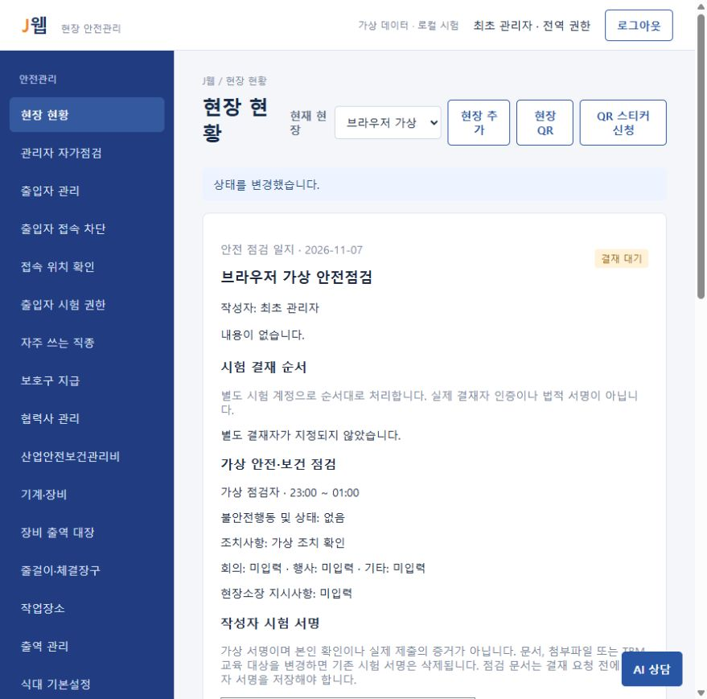
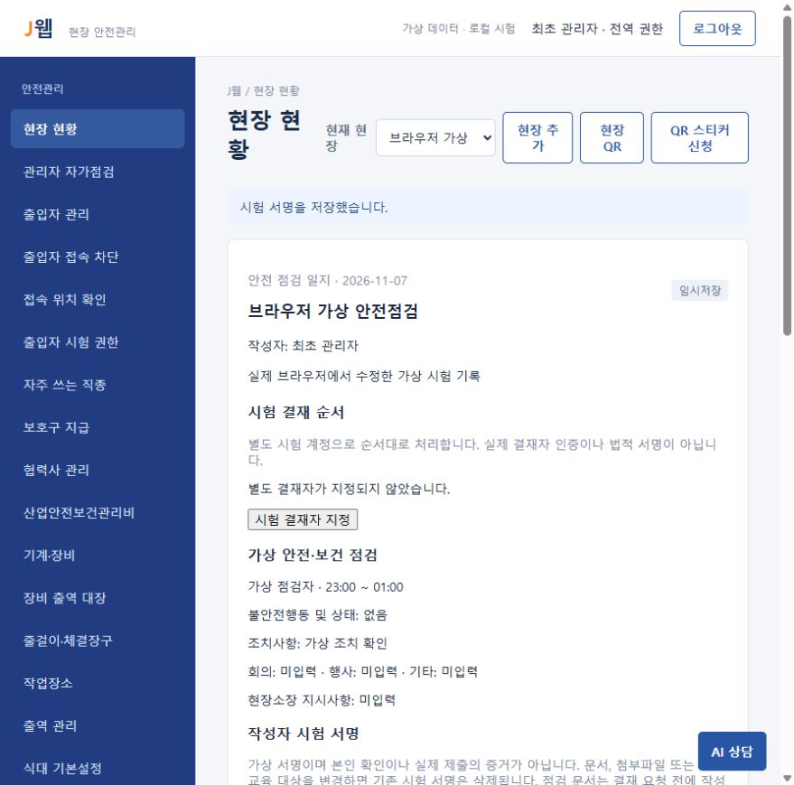
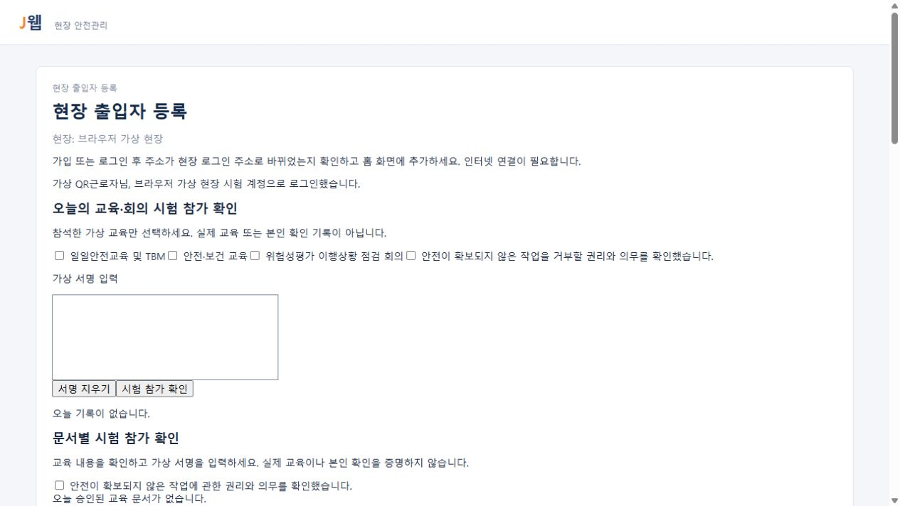
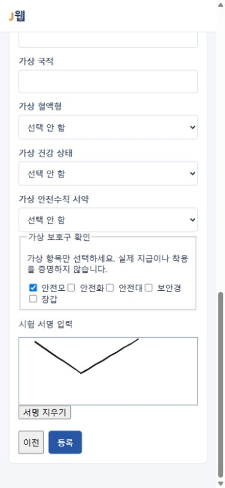
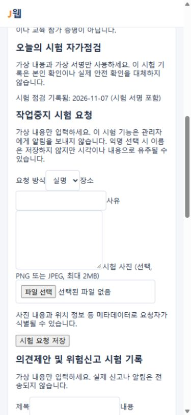

# 실제 브라우저 시험 기록

2026-11-07, 별도 SQLite와 가상 계정만 사용하는 로컬 서버를 Codex 내장 브라우저에서 시험했습니다. 기준 코드는 `bef3e94`와 작성자 서명 저장 성공 안내 수정입니다. 외부 AI·메일·문자 연결은 설정하지 않았습니다.

| 수행한 흐름 | 화면에서 확인한 결과 |
| --- | --- |
| 가상 관리자 로그인 | 가상 현장의 대시보드와 메뉴가 표시됨 |
| 안전점검 작성·저장 | 점검자, 23:00~01:00의 밤샘 시간, 조치 내용이 상세에 유지됨. 빈 불안전 상태는 `없음`으로 표시됨 |
| 작성자 서명 없는 결재 요청 | 서명을 저장하라는 오류가 표시되고 임시저장 상태가 유지됨 |
| 서명 패드에 직접 드래그 후 저장 | 저장된 서명 이미지가 표시됨 |
| 서명 후 결재 요청 | `결재 대기` 상태와 처리 이력이 표시됨 |
| 요청 취소·문서 수정 | 임시저장 상태로 돌아오고, 수정 후 현재 작성자 서명이 해제됨 |
| 오류 후 다시 서명 저장 | 이전 오류가 `시험 서명을 저장했습니다.` 안내로 바뀜 |
| 현장 QR 생성과 가입 열기 | QR 이미지·접속 주소·가입 가능 기한이 표시됨 |
| 화면 QR 판독 | 캡처한 QR을 jsQR로 판독한 주소가 실제 가입 화면을 연 주소와 일치함 |
| QR 주소에서 신규 가입 | 가상 이름·직영 구분·직종·생년월일·전화번호·보호구·직접 그린 시험 서명을 입력해 등록 완료 안내가 표시됨 |
| 이름·생년월일 로그인 | 가입한 가상 계정으로 로그인되고 당일 출역 1일이 표시됨 |

## 화면 근거

모든 이름과 현장은 시험용입니다.

## 모바일 폭 추가 시험

2026-11-07, 기준 코드 `8ceebbb`에 상단 배치 수정을 적용하고 별도 가상 DB로 시험했습니다.

- Chrome 모바일·터치 에뮬레이션의 390px 및 320px 폭에서 상단 제목과 버튼이 56px 헤더 안에 표시되고, 문서의 가로 폭이 화면 폭을 넘지 않음을 확인했습니다. 메뉴 열기·출입자 관리 이동·메뉴 닫기도 확인했습니다.
- 390px로 설정한 Codex 내장 브라우저에서 QR 주소의 가입 화면을 열고 가상 가입 정보를 입력했습니다. 서명 패드에 직접 드래그하여 등록하고 이름·생년 정보로 로그인해 당일 출역 1일 표시를 확인했습니다.
- 가상 자가점검 네 항목을 선택하고 직접 그린 서명과 함께 저장하여 `시험 점검 기록됨` 안내를 확인했습니다.
- 서버를 종료한 뒤 DB를 다시 열어 가입자 1명·출역 1건·자가점검 1건을 확인했습니다. 네 응답은 모두 true이며 서명은 3,348바이트입니다. REA의 SQLite 조회도 같은 응답을 확인했고 ImHex와 DB SHA-256이 일치했습니다.

## 이번 시험에서 확인하지 않은 범위

실제 휴대전화·카메라 촬영, 위에 적지 않은 좁은 화면의 모든 기능, 물리적 위치 측정, 실제 알림 전달, 모든 역할·문서·첨부·인쇄의 화면 동작은 확인하지 않았습니다. 이 기록은 전체 기능의 동등성이나 운영 보안을 증명하지 않습니다. 이름과 생년 정보만 사용하는 로그인은 본인 인증이 아닙니다.
